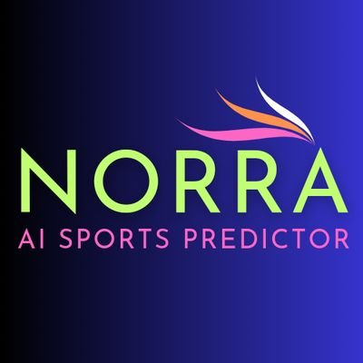

  

  # Norra AI

  ### Quantitative Football Intelligence & Probabilistic Match Forecast System
  
  
  
  
  

---

## 📌 Overview

**Norra AI** is a state-of-the-art quantitative football intelligence platform engineered for sports analysts, data enthusiasts, and bettors seeking mathematical superiority over recreational market biases.

Rather than treating football as a guesswork exercise, Norra AI operates as a probabilistic analytical engine. Every fixture across 40+ premier global and domestic competitions is synthesized through rigorous statistical modeling, evaluating match dynamics, expected goals distributions, and true zero-vig probabilities to surface authentic **Positive Expected Value (+EV)** opportunities.

---

## ⚡ Core Capabilities

- **Deterministic Multi-Market Analytics**: Evaluates fixture probabilities across Match Winner (1X2), Double Chance (1X, 12, X2), Both Teams to Score (GG / NG), Over/Under Goal lines (Over 1.5, Under 3.5), and Draw No Bet (DNB).
- **Automated Expected Value (+EV) Filtering**: Identifies mathematical market discrepancies where model-projected likelihood exceeds the bookmaker's implied break-even probability.
- **Daily Banker Winning Engine**: Synthesizes the day's highest-conviction selections into tight, low-variance 2-leg tickets designed for steady compounding.
- **Real-Time Matchday Progression**: Live score synchronization tracking in-play matches, minute telemetry, and automated result resolution.
- **Progressive Web App (PWA)**: Installable directly on iOS and Android devices with instant splashscreen launch, offline capability, and real-time push notifications.
- **Interactive Multi-Slip Builder**: User-friendly bet slip calculator supporting decimal, fractional, and American odds formats with instant potential return simulation.

---

## 🧮 The Quantitative Pipeline

Amateur models and retail sports bettors frequently fail because they treat match forecasting as simple classification. Norra AI approaches the problem mathematically:

### 1. Zero-Vig Probability Calibration (Shin Method)
Standard proportional normalization fails because bookmakers load disproportionate vigorish (margin) onto longshots and public favorites. Norra AI employs the Shin de-vigging method, solving an implicit non-linear equation to isolate the proportion of informed trading volume ($z$) and uncover true fair probabilities.

### 2. Goal Expectancy & Bivariate Distribution
Computes expected goals ($\lambda_{\text{home}}$, $\mu_{\text{away}}$) with low-score correlation adjustments to construct full scoreline matrices from which derivative betting markets are derived with mathematical consistency.

### 3. Positive Expected Value (+EV)
Recommendations are triggered only when positive expected value exceeds verifiable transaction costs and market friction:

$$\text{EV} = (P_{\text{model}} \times \text{Decimal Odds}) - 1 > 0$$

### 4. Capital Preservation & Bankroll Discipline (Quarter-Kelly)
To prevent the rapid drawdowns common to full Kelly betting, the platform recommends a conservative Quarter-Kelly staking framework ($f^* / 4$, capped at $2.5\%$ of bankroll), maximizing geometric compounding while safeguarding against variance.

---

## 🎴 Anatomy of a Norra AI Match Card

Each fixture is rendered as an ultra-compact, high-density analytical card engineered for immediate clarity:

- **🏷️ Competition Meta**: Displays the league title, kickoff time standardized strictly to **GMT+1 (West Africa Time)**, and real-time match state (*Scheduled*, *Live*, or *Concluded*).
- **⚡ Quantitative Badges**:
  - `⚡ +EV Edge`: Signals a verified mathematical advantage over current market prices.
  - `📉 Steam`: Indicates significant sharp market movement.
- **🛡️ Golden Verdict Pill**: The primary algorithmically selected pick (e.g. `1X`, `Ov1.5`, `1 DNB`) with fair market odds.
- **📂 Expandable Details Drawer**: Unveils comprehensive alternative markets, suggested Kelly bankroll sizing, and head-to-head metrics.

---

## 📖 Market Notation Key

| Notation | Market Category | Meaning |
| :--- | :--- | :--- |
| **1 / X / 2** | Match Outcome | **1**: Home Win \| **X**: Draw \| **2**: Away Win |
| **1X / X2 / 12** | Double Chance | **1X**: Home or Draw \| **X2**: Draw or Away \| **12**: Either Wins (No Draw) |
| **DNB** | Draw No Bet (Shield) | Win on victory; full stake refunded if match ends in a draw |
| **Ov1.5 / Un3.5** | Goal Totals | **Over 1.5**: 2+ total goals \| **Under 3.5**: 3 or fewer total goals |
| **GG / NG** | Both Teams to Score | **GG**: Both teams score \| **NG**: At least one clean sheet |
| **⭐ Safe Pick** | Conviction Tier | High statistical certainty exceeding 80% |

---

## 🏆 The Bettor's Strategic Playbook

1. **Prioritize Win Certainty & Compounding**: Build long-term results through resilient 2-leg to 3-leg slips rather than speculative 10-leg accumulators.
2. **Strict Bankroll Discipline**: Limit single-ticket exposure to 1%–2.5% of total bankroll. Avoid tilt and never chase losses.
3. **Exploit Draw-Shielded Lines**: Draws occur in ~26%–28% of all football matches. Double Chance and Draw No Bet transform competitive draws into profitable or protected outcomes.
4. **Track Closing Line Value (CLV)**: Consistently beating the closing line guarantees positive expected returns over a large sample size.

---

## 📱 Progressive Web App (PWA)

Norra AI is fully optimized as a standalone mobile application:
- **Instant Launch**: Hardware-accelerated splash screen on iOS and Android.
- **Offline Reliability**: Service worker caching allows offline review of previously synced predictions.
- **Real-Time Push Alerts**: Optional device notifications for freshly synced daily fixtures and matchday milestones.

To install, visit the site in your mobile browser, tap the browser menu, and select **"Add to Home Screen"** or **"Install App"**.

---

## 🛡️ Responsible Gaming & Age Notice

Norra AI is purely a mathematical analytical tool intended for informational, statistical, and entertainment purposes for adult audiences aged **18+**. Norra AI does not accept wagers, host betting pools, or provide real-money gambling services.

If you or someone you know is affected by gambling, free and confidential support is available:
- **BeGambleAware**: [www.begambleaware.org](https://www.begambleaware.org/)
- **GamStop**: [www.gamstop.co.uk](https://www.gamstop.co.uk/)
- **Take Time To Think**: [www.taketimetothink.co.uk](https://www.taketimetothink.co.uk/)

---

## 📄 License & Intellectual Property

This project is close-sourced; most of its files are not publicly available. Unauthorized scraping, automated mass harvesting, or redistribution of proprietary prediction feeds is prohibited under platform terms.
